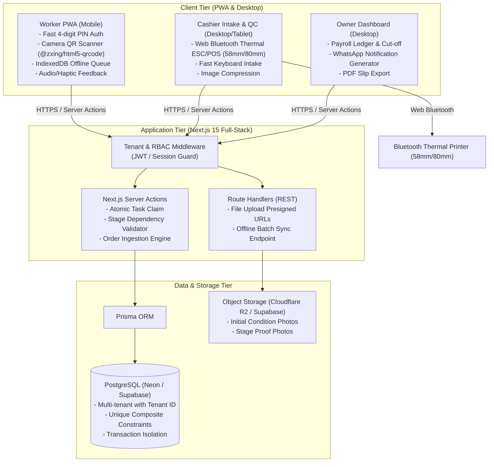
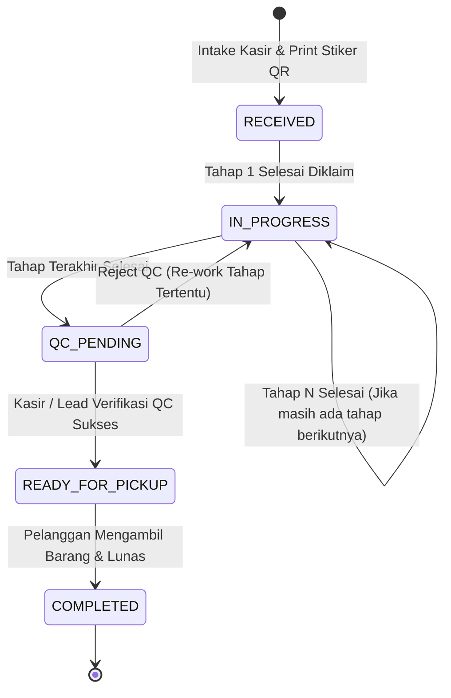
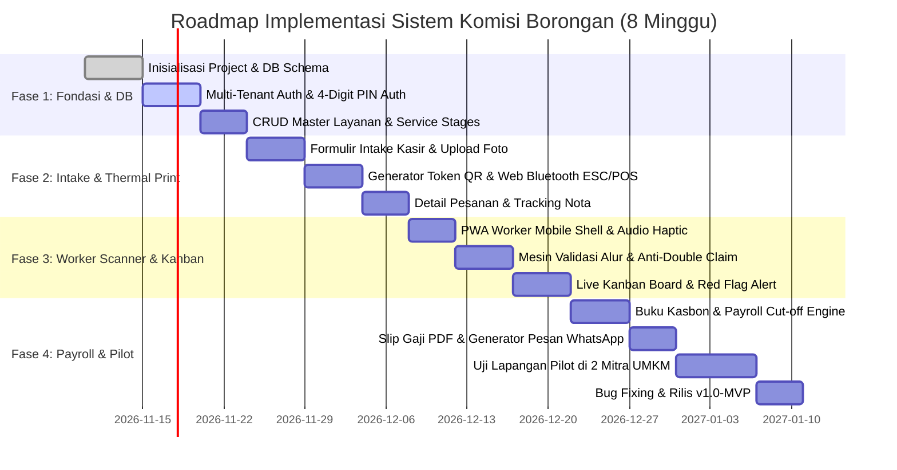

# Implementation Plan: Sistem Pelacakan Kerja & Komisi Borongan Multi-Tahap (v1.0-MVP)

Rencana implementasi teknis ini disusun berdasarkan dokumen spesifikasi produk [prd.md](./prd.md) untuk mentransformasikan kebutuhan bisnis UMKM borongan menjadi arsitektur perangkat lunak yang andal, modular, dan terukur.

---

## 1. Arsitektur Sistem & Spesifikasi Tech Stack

### 1.1 Diagram Arsitektur Tingkat Tinggi
Aplikasi mengadopsi arsitektur monolit modern modular berbasis Next.js 15 App Router dengan Server Actions dan Route Handlers.



### 1.2 Tech Stack Selection & Justification

| Layer / Komponen | Teknologi Terpilih | Justifikasi Teknis |
| :--- | :--- | :--- |
| **Framework Full-Stack** | Next.js 15 (App Router, React 19) | Efisiensi monorepo, zero API-boilerplate dengan Server Actions, performa SSR/RSC tinggi untuk dasbor kasir/owner. |
| **Styling & Komponen** | Tailwind CSS v4 + Shadcn UI | Komponen UI aksesibel, modular, mudah dikustomisasi untuk kontrol tombol besar ($\ge 56\text{ px}$) bagi teknisi. |
| **State & PWA Offline** | Serwist / Next-PWA + Dexie.js (IndexedDB) | Menyimpan antrean pemindaian saat workshop berada di area blindspot/tanpa sinyal internet (*offline-first sync*). |
| **Kamera & QR Engine** | `@zxing/browser` atau `html5-qrcode` | Kompatibilitas luas di browser Safari iOS & Chrome Android tanpa perlu instalasi aplikasi toko native. |
| **Konektivitas Thermal** | Web Bluetooth API + ESC/POS Encoder | Cetak stiker label QR instan dari browser tanpa driver perantara desktop/print server. |
| **Database & ORM** | PostgreSQL (Neon / Supabase) + Prisma ORM | Integritas ACID yang ketat untuk mencegah *double-claim* komisi menggunakan transaksi database dan *composite unique constraints*. |
| **Autentikasi** | Auth.js (NextAuth v5) + PIN Credential Provider | Multi-tenant auth untuk Owner/Kasir (Email/Password), dan Login Cepat 4-Digit PIN untuk Teknisi Lapangan pada perangkat bersama (*shared tablet/phone*). |
| **Penyimpanan Media** | Cloudflare R2 / Supabase Storage via S3 SDK | Penyimpanan berkas bukti foto fisik murah tanpa egress fee, kompresi foto di sisi browser via `browser-image-compression`. |

---

## 2. Skema Basis Data & Spesifikasi Prisma

Implementasi skema basis data diwujudkan melalui `prisma/schema.prisma` yang mencakup isolasi tenant, penegakan integritas data, dan pencegahan duplikasi komisi.

### 2.1 Prisma Data Model (`schema.prisma`)

```prisma
datasource db {
  provider = "postgresql"
  url      = env("DATABASE_URL")
}

generator client {
  provider = "prisma-client-js"
}

enum Role {
  OWNER
  CASHIER
  WORKER
}

enum OrderStatus {
  RECEIVED
  IN_PROGRESS
  QC_PENDING
  READY_FOR_PICKUP
  COMPLETED
  CANCELLED
}

enum PaymentStatus {
  UNPAID
  DOWN_PAYMENT
  PAID
}

model Tenant {
  id           String        @id @default(uuid())
  name         String
  phone        String?
  address      String?
  createdAt    DateTime      @default(now()) @map("created_at")
  updatedAt    DateTime      @updatedAt @map("updated_at")

  users        User[]
  services     Service[]
  orders       Order[]
  cashAdvances CashAdvance[]
  payrollRuns  PayrollRun[]

  @@map("tenants")
}

model User {
  id           String        @id @default(uuid())
  tenantId     String        @map("tenant_id")
  fullName     String        @map("full_name")
  email        String?       @unique
  passwordHash String?       @map("password_hash")
  pinCodeHash  String?       @map("pin_code_hash") // 4-digit PIN hashed with bcrypt
  role         Role          @default(WORKER)
  isActive     Boolean       @default(true) @map("is_active")
  createdAt    DateTime      @default(now()) @map("created_at")

  tenant       Tenant        @relation(fields: [tenantId], references: [id], onDelete: Cascade)
  taskLogs     TaskLog[]
  cashAdvances CashAdvance[]
  payrollItems PayrollItem[]

  @@index([tenantId, role])
  @@map("users")
}

model Service {
  id          String         @id @default(uuid())
  tenantId    String         @map("tenant_id")
  name        String
  description String?
  basePrice   Decimal        @map("base_price") @db.Decimal(12, 2)
  isActive    Boolean        @default(true) @map("is_active")
  createdAt   DateTime       @default(now()) @map("created_at")

  tenant      Tenant         @relation(fields: [tenantId], references: [id], onDelete: Cascade)
  stages      ServiceStage[]
  orderItems  OrderItem[]

  @@index([tenantId])
  @@map("services")
}

model ServiceStage {
  id               String      @id @default(uuid())
  serviceId        String      @map("service_id")
  stageName        String      @map("stage_name")
  stepOrder        Int         @map("step_order") // 1, 2, 3... Urutan tahapan wajib
  pieceRateAmount  Decimal     @map("piece_rate_amount") @db.Decimal(12, 2)
  estimatedMinutes Int         @default(30) @map("estimated_minutes")
  isPhotoRequired  Boolean     @default(false) @map("is_photo_required")
  createdAt        DateTime    @default(now()) @map("created_at")

  service          Service     @relation(fields: [serviceId], references: [id], onDelete: Cascade)
  taskLogs         TaskLog[]

  @@unique([serviceId, stepOrder]) // Menjamin urutan nomor tahapan unik per layanan
  @@index([serviceId])
  @@map("service_stages")
}

model Order {
  id            String        @id @default(uuid())
  tenantId      String        @map("tenant_id")
  orderNumber   String        @map("order_number") // Format: TRX-YYMM-XXXX
  customerName  String        @map("customer_name")
  customerPhone String        @map("customer_phone")
  totalAmount   Decimal       @map("total_amount") @db.Decimal(12, 2)
  paymentStatus PaymentStatus @default(UNPAID) @map("payment_status")
  createdAt     DateTime      @default(now()) @map("created_at")
  updatedAt     DateTime      @updatedAt @map("updated_at")

  tenant        Tenant        @relation(fields: [tenantId], references: [id], onDelete: Cascade)
  items         OrderItem[]

  @@unique([tenantId, orderNumber])
  @@index([tenantId, createdAt])
  @@map("orders")
}

model OrderItem {
  id             String      @id @default(uuid())
  orderId        String      @map("order_id")
  serviceId      String      @map("service_id")
  itemQrCode     String      @unique @map("item_qr_code") // Token QR unik per item fisik
  itemNotes      String?     @map("item_notes") // Kerusakan awal, noda spesifik, dll
  initialPhotos  String[]    @default([]) @map("initial_photos") // URL foto saat intake kasir
  currentStatus  OrderStatus @default(RECEIVED) @map("current_status")
  hasRedFlag     Boolean     @default(false) @map("has_red_flag") // Masalah kendala dari worker
  redFlagNotes   String?     @map("red_flag_notes")
  createdAt      DateTime    @default(now()) @map("created_at")
  updatedAt      DateTime    @updatedAt @map("updated_at")

  order          Order       @relation(fields: [orderId], references: [id], onDelete: Cascade)
  service        Service     @relation(fields: [serviceId], references: [id], onDelete: Restrict)
  taskLogs       TaskLog[]

  @@index([itemQrCode])
  @@index([orderId])
  @@map("order_items")
}

model TaskLog {
  id             String       @id @default(uuid())
  orderItemId    String       @map("order_item_id")
  serviceStageId String       @map("service_stage_id")
  workerId       String       @map("worker_id")
  earnedRate     Decimal      @map("earned_rate") @db.Decimal(12, 2) // IMMUTABLE snapshot komisi
  photoProofUrl  String?      @map("photo_proof_url")
  completedAt    DateTime     @default(now()) @map("completed_at")
  payrollItemId  String?      @map("payroll_item_id") // Terisi saat penutupan payroll

  orderItem      OrderItem    @relation(fields: [orderItemId], references: [id], onDelete: Cascade)
  serviceStage   ServiceStage @relation(fields: [serviceStageId], references: [id], onDelete: Restrict)
  worker         User         @relation(fields: [workerId], references: [id], onDelete: Restrict)
  payrollItem    PayrollItem? @relation(fields: [payrollItemId], references: [id], onDelete: SetNull)

  // ATURAN KRITIS: Mencegah klaim ganda atas tahap yang sama pada item yang sama
  @@unique([orderItemId, serviceStageId], name: "unique_item_stage_execution")
  @@index([workerId, completedAt])
  @@index([payrollItemId])
  @@map("task_logs")
}

model CashAdvance {
  id            String       @id @default(uuid())
  tenantId      String       @map("tenant_id")
  workerId      String       @map("worker_id")
  amount        Decimal      @db.Decimal(12, 2)
  notes         String?
  issueDate     DateTime     @default(now()) @map("issue_date")
  isSettled     Boolean      @default(false) @map("is_settled")
  payrollItemId String?      @map("payroll_item_id")
  createdAt     DateTime     @default(now()) @map("created_at")

  tenant        Tenant       @relation(fields: [tenantId], references: [id], onDelete: Cascade)
  worker        User         @relation(fields: [workerId], references: [id], onDelete: Restrict)
  payrollItem   PayrollItem? @relation(fields: [payrollItemId], references: [id], onDelete: SetNull)

  @@index([tenantId, workerId, isSettled])
  @@map("cash_advances")
}

model PayrollRun {
  id             String        @id @default(uuid())
  tenantId       String        @map("tenant_id")
  periodStart    DateTime      @map("period_start")
  periodEnd      DateTime      @map("period_end")
  totalGross     Decimal       @map("total_gross") @db.Decimal(12, 2)
  totalAdvances  Decimal       @map("total_advances") @db.Decimal(12, 2)
  totalNetPayout Decimal       @map("total_net_payout") @db.Decimal(12, 2)
  closedByUserId String        @map("closed_by_user_id")
  createdAt      DateTime      @default(now()) @map("created_at")

  tenant         Tenant        @relation(fields: [tenantId], references: [id], onDelete: Cascade)
  items          PayrollItem[]

  @@index([tenantId, createdAt])
  @@map("payroll_runs")
}

model PayrollItem {
  id             String        @id @default(uuid())
  payrollRunId   String        @map("payroll_run_id")
  workerId       String        @map("worker_id")
  grossAmount    Decimal       @map("gross_amount") @db.Decimal(12, 2)
  advanceAmount  Decimal       @map("advance_amount") @db.Decimal(12, 2)
  netAmount      Decimal       @map("net_amount") @db.Decimal(12, 2)
  taskCount      Int           @map("task_count")
  isPaid         Boolean       @default(false) @map("is_paid")

  payrollRun     PayrollRun    @relation(fields: [payrollRunId], references: [id], onDelete: Cascade)
  worker         User          @relation(fields: [workerId], references: [id], onDelete: Restrict)
  taskLogs       TaskLog[]
  cashAdvances   CashAdvance[]

  @@unique([payrollRunId, workerId])
  @@map("payroll_items")
}
```

---

## 3. Logika Bisnis Inti & Mesin Validasi Pengerjaan

### 3.1 State Machine Alur Barang & Validasi Pengerjaan Tahap



### 3.2 Algoritma Klaim Tahapan & Pencegahan Loncat Tahap
Logika transaksi saat seorang teknisi memindai QR code dieksekusi secara atomik menggunakan Prisma Transaction (`$transaction`):

```typescript
// Pseudocode Logika Validasi Klaim Tahap (Server Action)
export async function claimStageTask({
  itemQrCode,
  serviceStageId,
  workerId,
  photoProofUrl
}: ClaimInput) {
  return await prisma.$transaction(async (tx) => {
    // 1. Ambil item beserta seluruh stages dan logs yang sudah selesai
    const item = await tx.orderItem.findUnique({
      where: { itemQrCode },
      include: {
        service: {
          include: { stages: { orderBy: { stepOrder: 'asc' } } }
        },
        taskLogs: true
      }
    });

    if (!item) throw new Error("Item tidak ditemukan dalam sistem.");
    if (item.currentStatus === 'COMPLETED') {
      throw new Error("Item ini sudah berstatus selesai/diambil.");
    }

    // 2. Temukan tahap yang ingin diklaim
    const targetStage = item.service.stages.find(s => s.id === serviceStageId);
    if (!targetStage) throw new Error("Tahap tidak valid untuk layanan ini.");

    // 3. Verifikasi apakah tahap ini sudah pernah diselesaikan (Anti-Double Claim)
    const alreadyCompleted = item.taskLogs.some(
      log => log.serviceStageId === serviceStageId
    );
    if (alreadyCompleted) {
      throw new Error("Tahapan ini sudah pernah diselesaikan sebelumnya.");
    }

    // 4. Verifikasi dependensi urutan tahapan (Anti-Skip Tahap)
    if (targetStage.stepOrder > 1) {
      const previousStages = item.service.stages.filter(
        s => s.stepOrder < targetStage.stepOrder
      );
      const completedStageIds = new Set(item.taskLogs.map(l => l.serviceStageId));
      
      const uncompletedPredecessor = previousStages.find(
        s => !completedStageIds.has(s.id)
      );

      if (uncompletedPredecessor) {
        throw new Error(
          `Tahapan sebelumnya (${uncompletedPredecessor.stageName}) belum diselesaikan.`
        );
      }
    }

    // 5. Simpan TaskLog dengan snapshot tarif saat ini
    const taskLog = await tx.taskLog.create({
      data: {
        orderItemId: item.id,
        serviceStageId: targetStage.id,
        workerId: workerId,
        earnedRate: targetStage.pieceRateAmount, // SNAPSHOT IMMUTABLE
        photoProofUrl: photoProofUrl || null
      }
    });

    // 6. Update Status Order Item
    const totalStages = item.service.stages.length;
    const completedStagesCount = item.taskLogs.length + 1;

    let nextStatus = OrderStatus.IN_PROGRESS;
    if (completedStagesCount >= totalStages) {
      nextStatus = OrderStatus.QC_PENDING;
    }

    await tx.orderItem.update({
      where: { id: item.id },
      data: { currentStatus: nextStatus }
    });

    return { success: true, earnedRate: targetStage.pieceRateAmount, nextStatus };
  });
}
```

---

## 4. Rincian Antarmuka Pengguna & Integrasi Perangkat

### 4.1 Modul Worker PWA Scanner (Zero-Typing UI)
* **Viewport & Layout:** Rasio layar penuh pada peramban HP, orientasi potret.
* **Header Saldo Transparan:** Menampilkan ringkasan komisi `Hari Ini (Rp)` dan `Minggu Ini (Rp)` yang diperbarui secara reaktif setiap kali scan berhasil.
* **Area Pemindai Kamera:**
  * Kontainer video proporsi 1:1 di tengah layar dengan garis panduan bidik (*reticle viewfinder*).
  * Tombol switch senter/flash jika perangkat mendukung `torch`.
* **Action Drawer (Sheet):**
  * Begitu QR terdeteksi, modal muncul dari bawah menampilkan rincian barang: Jenis Sepatu/Pakaian, Catatan Kerusakan, dan Tahapan yang siap diklaim.
  * Tombol konfirmasi sentuh berukuran raksasa ($\ge 64\text{ px}$ tinggi) berwarna hijau kontras: **"Selesaikan Tahap [Nama Tahap] - Rp[Nominal]"**.
* **Audio-Haptic Feedback:**
  * `AudioContext` sintetis internal: Frekuensi 880Hz (A5) 150ms untuk *Success Beep*, 220Hz (A3) 350ms untuk *Error Beep*.
  * `navigator.vibrate([100])` untuk getaran sentuhan sukses; `navigator.vibrate([100, 50, 100])` untuk galat.

### 4.2 Integrasi Printer Thermal Bluetooth (ESC/POS 58mm & 80mm)
* Menggunakan standar **Web Bluetooth API** (`navigator.bluetooth.requestDevice`) yang terhubung langsung ke printer thermal portabel.
* Payload data di-encode dalam array `Uint8Array` format ESC/POS standar:
  1. `[0x1B, 0x40]` (Initialize printer)
  2. `[0x1B, 0x61, 0x01]` (Align center)
  3. Header Toko & Nomor Transaksi
  4. Perintah pencetakan barcode/QR ESC/POS (`GS ( k`) atau pencetakan bit-image raster canvas QR 200x200 px.
  5. Catatan khusus item & pemisah garis putus-putus.
  6. `[0x1D, 0x56, 0x41, 0x10]` (Feed & Cut paper).

### 4.3 Papan Kanban Operasional & Pelacakan Kualitas
* Menampilkan kartu-kartu item pesanan yang dikelompokkan berdasarkan kolom:
  1. **Menunggu Pengerjaan** (`RECEIVED`)
  2. **Sedang Dikerjakan** (`IN_PROGRESS` - dilengkapi indikator progress tahap, misal: *Tahap 1/3*)
  3. **Pemeriksaan QC** (`QC_PENDING` - tombol aksi untuk Kasir/Owner: Lulus / Kembalikan)
  4. **Siap Diambil** (`READY_FOR_PICKUP`)
  5. **Selesai / Diambil** (`COMPLETED`)
* **Red Flag Indicator:** Jika ada teknisi yang menandai kendala pada item (misal: "Bahan sol getas, rawan patah saat disikat"), kartu menampilkan badge merah berkedip di dasbor kasir beserta tombol pintas: *"Kirim WA Konfirmasi ke Pelanggan"*.

### 4.4 Modul Payroll Ledger & Generator WhatsApp
* **Formula Rekapitulasi Otomatis:**
  $$\text{Net Payout} = \sum_{\text{item}} \text{TaskLog.earnedRate} - \sum \text{CashAdvance.amount}$$
* **WhatsApp Payload Builder:**
  Sistem membuat deep link `https://wa.me/{phone}?text={encodedString}` yang berisi ringkasan rapi:
  ```text
  Halo [Nama Pekerja],
  Berikut ringkasan slip gaji borongan periode 03 Nov - 08 Nov 2026:
  
  Total Pekerjaan Selesai: 48 item
  Total Upah Kotor: Rp1.420.000
  Potongan Kasbon: -Rp200.000 (Kasbon tgl 04 Nov)
  ------------------------------------
  TOTAL GAJI BERSIH: Rp1.220.000
  
  Terima kasih atas kerja kerasnya minggu ini!
  ```

---

## 5. Rencana Kerja & Roadmap 8 Minggu (WBS)



### Rincian Deliverable per Sprint

#### Sprint 1 (Minggu 1–2): Fondasi Sistem, Database & Master Workflow
* **Tugas 1.1:** Setup repository Next.js 15, Tailwind CSS, Shadcn UI, konfigurasi Prisma ORM dengan PostgreSQL Neon/Supabase.
* **Tugas 1.2:** Implementasi multi-tenant data isolation & middleware otentikasi (Owner/Kasir login password, Worker login 4-digit PIN).
* **Tugas 1.3:** Pembangunan modul Master Layanan: formulir penambahan tahapan dinamis, urutan langkah (*step order*), dan penetapan tarif komisi per langkah.
* **Kriteria Keberhasilan Sprint 1:** Admin dapat membuat 1 tenant baru, menambahkan layanan (misal: "Cuci Sepatu Deep Clean" dengan 3 tahapan), dan mendaftarkan 3 user pekerja dengan PIN masing-masing.

#### Sprint 2 (Minggu 3–4): Kasir Intake Desk & Generator Tiket QR Thermal
* **Tugas 2.1:** Pembuatan halaman Intake Kasir: pencarian pelanggan, pemilihan layanan, input catatan kerusakan awal, dan kompresi serta upload foto ke R2/Supabase Storage.
* **Tugas 2.2:** Engine generator token QR acak unik per item barang fisik (`order_items.item_qr_code`).
* **Tugas 2.3:** Integrasi modul Web Bluetooth ESC/POS driver untuk mencetak label stiker 58mm/80mm langsung dari antarmuka browser.
* **Kriteria Keberhasilan Sprint 2:** Kasir berhasil menginput 1 order berisi 2 pasang sepatu, mengambil foto sol jebol via kamera tablet/HP kasir, dan mencetak 2 label QR thermal secara nirkabel dalam $< 30$ detik.

#### Sprint 3 (Minggu 5–6): Antarmuka PWA Worker Scanner & Pipeline Monitoring
* **Tugas 3.1:** Konfigurasi PWA (manifest, service worker) dan UI Worker mobile scanner dengan tombol $\ge 56\text{ px}$.
* **Tugas 3.2:** Integrasi library scanner kamera (`@zxing/browser` atau `html5-qrcode`) yang langsung membuka bidikan kamera saat aplikasi dibuka.
* **Tugas 3.3:** Implementasi Server Action `claimStageTask` dengan verifikasi urutan tahapan dan penguncian transaksi database anti-klaim ganda.
* **Tugas 3.4:** Pembuatan papan monitoring Kanban interaktif dengan filter per layanan, kartu status, dan fitur "Tandai Kendala (Red Flag)".
* **Kriteria Keberhasilan Sprint 3:** Pekerja A scan QR barang $\rightarrow$ menekan klaim tahap 1 $\rightarrow$ berhasil dalam $< 5$ detik dengan audio beep; Pekerja B mencoba scan tahap 2 sebelum tahap 1 selesai $\rightarrow$ ditolak dengan pesan peringatan jelas; Saldo hari ini pekerja terupdate seketika.

#### Sprint 4 (Minggu 7–8): Buku Besar Payroll, Kasbon & Uji Lapangan Pilot
* **Tugas 4.1:** Pembuatan modul Kasbon (*Cash Advance Ledger*): pencatatan pengajuan kasbon pekerja, verifikasi owner, dan pemantauan status belum terpotong (`is_settled = false`).
* **Tugas 4.2:** Engine Tutup Buku Penggajian Mingguan: agregasi seluruh `task_logs` dalam periode terpilih, pengurangan akumulasi kasbon, dan pencetakan batch slip gaji PDF.
* **Tugas 4.3:** Fitur kirim pesan WhatsApp otomatis dengan rincian rinci per item pekerjaan.
* **Tugas 4.4:** Uji coba lapangan langsung (*pilot deployment*) pada 2 workshop UMKM (1 cuci sepatu dan 1 konveksi sablon) untuk validasi ketahanan pemindai di kondisi pencahayaan minim atau lensa kamera buram.
* **Kriteria Keberhasilan Sprint 4:** Owner dapat menyelesaikan penutupan buku gaji 10 pekerja dalam waktu $< 10$ menit tanpa ada selisih kasbon, dan slip gaji terkirim langsung ke nomor WhatsApp seluruh pekerja.

---

## 6. Strategi Pengujian & Skenario Verifikasi (QA)

| Kategori Pengujian | Kasus Uji (Test Case) | Perilaku yang Diharapkan |
| :--- | :--- | :--- |
| **Integritas Konkurensi** | Dua pekerja memindai dan menekan "Klaim Selesai" pada QR & tahap yang sama persis di detik yang bersamaan. | Hanya 1 transaksi yang berhasil (`HTTP 200`). Transaksi kedua ditolak database dengan `UniqueConstraintViolation` dan UI menampilkan pesan: *"Pekerjaan sudah diselesaikan oleh rekan Anda"*. |
| **Validasi Dependensi** | Pekerja mencoba mengklaim Tahap 3 (Finishing) sementara Tahap 2 (Repaint) belum terdaftar di `task_logs`. | Sistem mengembalikan pesan galat: *"Tahapan Repaint belum selesai"*. Saldo komisi pekerja tidak bertambah. |
| **Snapshot Tarif** | Master harga komisi Tahap 1 diubah dari Rp10.000 menjadi Rp12.000 pada pukul 14:00. | Pengerjaan yang dicatat sebelum pukul 14:00 tetap tercatat bernilai Rp10.000 pada slip gaji akhir pekan; pengerjaan setelah pukul 14:00 bernilai Rp12.000. |
| **Konektivitas Printer** | Kasir mematikan printer Bluetooth saat menekan tombol cetak tiket. | Sistem menangkap status *GATT Connection Failure* dan memberikan tombol fallback: *"Cetak via Dialog Browser Biasa"* atau *"Unduh Gambar Label QR"*. |
| **Ketahanan Kamera** | Pekerja memindai QR code dari sudut miring $45^\circ$, kondisi basah, atau pencahayaan temaram. | Algoritma binarisasi QR berhasil membaca string token dalam durasi $< 1.5$ detik. |

---

## 7. Keamanan, Isolasi Multi-Tenant & Skalabilitas

1. **Multi-Tenancy Guard:**
   * Seluruh query database melalui Prisma wajib mengikutsertakan filter `tenantId` yang diekstrak secara aman dari session JWT/Auth context untuk menjamin tidak ada kebocoran data antar-pemilik usaha.
2. **Pengamanan PIN Login Teknisi:**
   * PIN 4-digit disimpan dalam bentuk salt-hash menggunakan bcrypt. Rate limiting diterapkan (maksimal 5 kali percobaan salah per 10 menit per pekerja) untuk mencegah serangan *brute force*.
3. **Penyimpanan Gambar Hemat Bandwidth:**
   * Kompresi otomatis sisi browser sebelum upload: Foto awal resolusi asli diperkecil menjadi maksimal $1280\times 1280\text{ px}$ dengan kualitas WebP 80%, mereduksi ukuran berkas dari $\sim 4\text{ MB}$ menjadi $< 250\text{ KB}$ per foto, mempercepat proses upload pada jaringan seluler 4G/3G bengkel.

